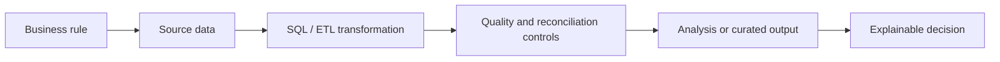

# Hernán Bevilacqua

### Data Analyst · Data Engineering · Controls & Automation

**English** | [Español](#español)

I develop and use three financial controls with Python, Pandas and Jupyter in my current university role, working with authorized Oracle data.

I use Oracle SQL to prepare data through joins, filters and aggregations, and Pandas to transform datasets, compare record counts and monetary amounts, and explain business exceptions.

My current controls compare:

- Academic enrollment vs concepts assigned to billing.
- Assigned concepts vs billed movements.
- Theoretical scholarship vs applied benefit.

The control knowledge originated in a legacy ACL Analytics process. The public project reconstructs the three workflows with synthetic data and rules, keeping operational records and configuration private. Alongside this work, my portfolio includes hands-on Azure data engineering projects.

## What I work with

`Python` · `Jupyter` · `Pandas` · `Oracle SQL` · `SQLAlchemy` · `oracledb` · `Azure Data Factory` · `ADLS Gen2` · `Databricks` · `PySpark` · `Power BI` · `Excel`

## Featured portfolio

| Project | What it demonstrates |
|---|---|
| [Financial Controls · Python, Pandas & Oracle SQL](https://github.com/hernano88/acl-sql-uade) | Three controls developed and used in my current work, reconstructed publicly: enrollment vs assigned billing, assigned vs billed movements, and theoretical vs applied scholarship. Demonstrates SQL preparation, Pandas reconciliation, business explanations and source/detail checks. |
| [Azure End-to-End Data Pipeline](https://github.com/hernano88/azure-end-to-end-data-pipeline) | ADF ingestion, ADLS Gen2, Databricks, PySpark, Spark SQL and Prophet forecasting in one documented flow. |
| [Databricks + ADLS + PySpark Lab](https://github.com/hernano88/databricks-adls-sql-pyspark-lab) | Hands-on lakehouse workflow: storage access, DataFrame transformations, Spark SQL and processed-data persistence. |
| [Azure Mapping Data Flow](https://github.com/hernano88/azure-mapping-dataflow-movies) | Visual ETL in Azure Data Factory with cleaning, derived fields and aggregations. |
| [MyFigure4ever Business Analytics](https://github.com/hernano88/myfigure4ever) | A real microbusiness translated into landed cost, unit economics, inventory, cohort analysis and auditable Excel controls. |
| [Telco Customer Churn ANN](https://github.com/hernano88/telco-customer-churn-ann) | End-to-end classification workflow using Python and an artificial neural network. |

## How I approach data work

- **Business first:** I clarify what the number means before choosing the tool.
- **Control by design:** totals, exceptions and traceability are part of the solution, not an afterthought.
- **Explainable delivery:** I document assumptions, metric definitions and limitations so the result can be defended in an interview or operational review.
- **Responsible evidence:** public examples use synthetic inputs or explicitly sanitized material; operational records and credentials stay private.

## Current direction

I am looking for opportunities in **Data Analytics** and **Data Engineering** where I can combine SQL, business understanding, data quality and Azure-based processing. This portfolio is available in English and Spanish because I am prepared to discuss the projects in either language.

---

## Español

### Analista de Datos · Ingeniería de Datos · Controles y Automatización

Desarrollo y utilizo tres controles financieros con Python, Pandas y Jupyter en mi trabajo actual en una universidad, sobre datos autorizados de Oracle.

Utilizo Oracle SQL para preparar datos mediante joins, filtros y agregaciones, y Pandas para transformar conjuntos de datos, comparar cantidades e importes y explicar excepciones de negocio.

Los tres controles comparan:

- Inscripciones vs conceptos asignados a facturación.
- Conceptos asignados vs movimientos facturados.
- Beca teórica vs beca aplicada.

El conocimiento de control se originó en un proceso anterior con ACL Analytics. El proyecto público reconstruye los tres flujos con datos y reglas sintéticos, manteniendo privados los registros operativos y la configuración. Además, mi portfolio incluye proyectos prácticos de ingeniería de datos en Azure.

### Proyecto destacado

[**Financial Controls · Python, Pandas & Oracle SQL**](https://github.com/hernano88/acl-sql-uade): tres controles de mi trabajo actual, reconstruidos públicamente para mostrar preparación SQL, conciliaciones en Pandas, justificaciones y cuadre de origen contra detalle.

### Mi forma de trabajar

- Primero entiendo la regla de negocio y la definición exacta de cada métrica.
- Incorporo conciliaciones, excepciones y trazabilidad desde el diseño.
- Documento supuestos y limitaciones para que cada resultado sea explicable.
- Utilizo datos sintéticos o material explícitamente sanitizado; los registros operativos y las credenciales quedan privados.

Busco oportunidades en **Data Analytics** e **Ingeniería de Datos** donde pueda combinar SQL, conocimiento del negocio, calidad de datos y procesamiento en Azure.
